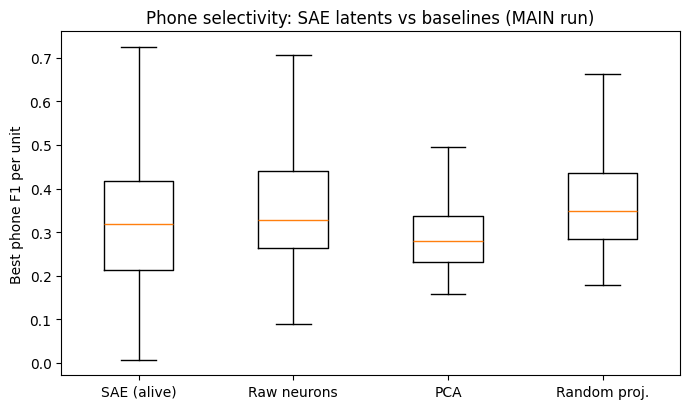
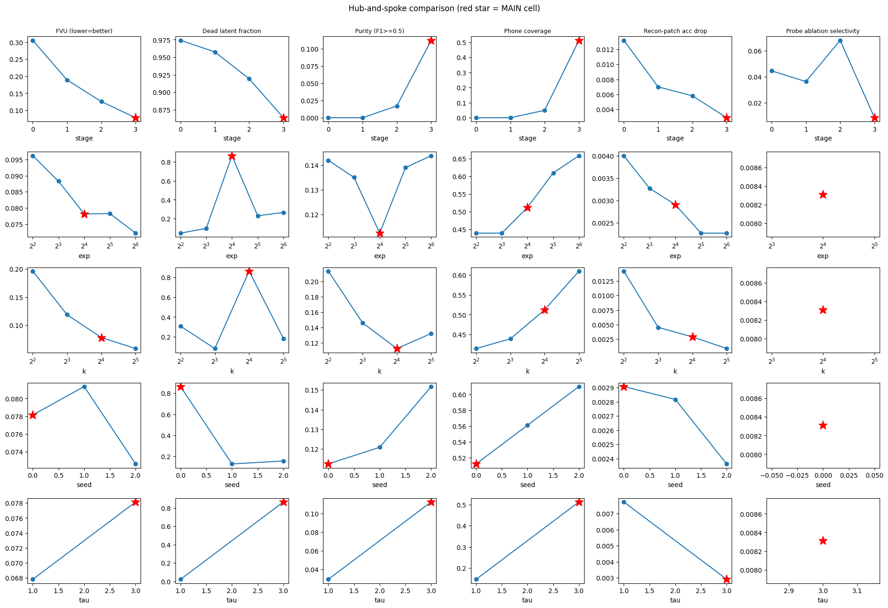
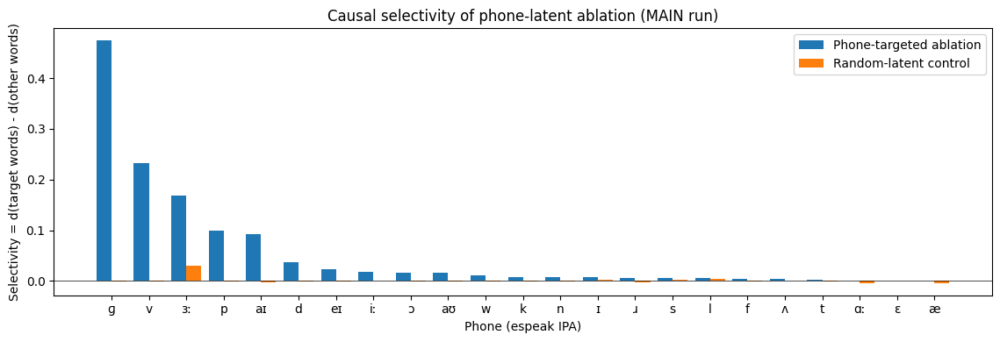
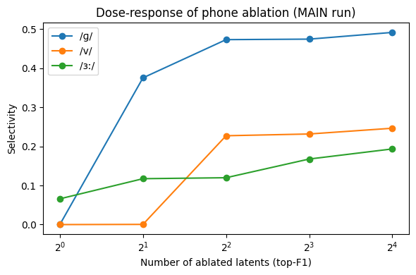
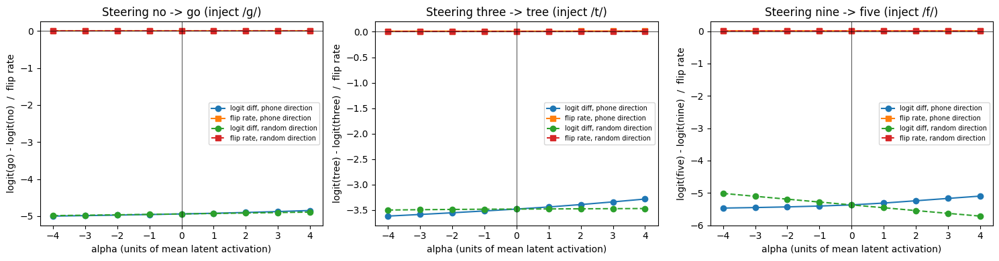

# Phone features in a small keyword-spotting CNN: an SAE study on BC-ResNet

This repository reports an experiment that applies a sparse autoencoder (SAE) to a small CNN for keyword spotting (BC-ResNet, τ=3). I asked three questions:

- **H1 (representation):** Do SAE latents capture phones better than the model's own neurons?
- **H2 (ablation):** If I remove the latents of a phone, does the model fail only on words that contain that phone?
- **H3 (steering):** If I add the direction of a phone, can I turn one word into another?

I wrote the hypotheses and their pass criteria before running the analysis. The short answer is: **H1 did not pass, H2 passed for some phones, and H3 did not pass.** In other words, removing a phone's latents could break the matching words, but adding the same kind of direction did not change the prediction.

Context: this work was done during a research internship at the SLPR Lab, Sungkyunkwan University (2026-04 – 2026-09).

---

## Contents

| Path | What it is |
|---|---|
| `notebooks/sae_experiments.ipynb` | The analysis notebook with its saved outputs. I translated the comments and markdown cells into English. The code and the outputs are unchanged, except that download progress-bar widgets were removed. |
| `figures/` | The figures, extracted from the notebook outputs without changes |
| `results/sae_runs_printed.csv` | The hub-and-spoke table, copied from the printed output of cell 6c |
| `results/ablation_main_printed.csv` | The per-phone ablation results, copied from the printed output of cell 10a (4 decimal places, as printed) |

The two CSV files are transcriptions of printed tables. They are not the original result files, which also had more columns.

---

## Setup

| Item | Value |
|---|---|
| Data | Google Speech Commands v2, 35 words, 105,829 utterances (train 84,843 / val 9,981 / test 11,005), log-Mel 40×101 |
| Model | BC-ResNet with 4 stages. τ=3 (test accuracy 0.9716) is the main model; τ=1 (0.9418) is used for comparison. |
| Phone labels | The known phone sequence (espeak) of each word was force-aligned to the audio with a wav2vec2 phoneme CTC model (`facebook/wav2vec2-lv-60-espeak-cv-ft`) and `torchaudio.functional.forced_align`. This gave 41 phones. Unaligned utterances: 0 / 105,829. Phone segment length in mel frames: median 10, p10 8, p90 18. |
| SAE input | The output of a stage, taken frame by frame. The C×F map of each frame is flattened into one vector, which has 300 dimensions at the last stage (stage 3) of τ=3. |
| SAE | TopK SAE trained with an MSE loss only. Decoder rows are renormalized to unit norm after every step. There is no auxiliary loss and no dead-latent re-initialization. 3 epochs, batch 4,096, lr 1e-3. Trained on all frames of 20,000 random training utterances. |
| MAIN configuration | τ=3, stage 3, expansion ×16 (4,800 latents), k=16, seed 0 |
| Spokes | Each spoke changes one axis of MAIN: stage {0, 1, 2}, expansion {4, 8, 32, 64}, k {4, 8, 32}, seed {1, 2}, τ {1}. (There was no τ=8 checkpoint, so the τ=8 spoke was skipped.) |
| Evaluation | The full test set. Frames near phone boundaries are excluded by a per-stage margin of [1, 1, 2, 3] frames. |

**Metrics**

- **FVU:** 1 − explained variance ratio. Lower means better reconstruction.
- **Purity:** among alive latents (≥ 50 firings), the fraction whose best F1 with some phone is at least 0.5.
- **Coverage:** among the 41 phones, the fraction that has at least one latent with F1 ≥ 0.5.
- **Recon drop:** clean accuracy − accuracy when the SAE reconstruction replaces the stage output.
- **Selectivity:** after ablation, (accuracy drop on words that contain the phone) − (accuracy drop on words that do not). The reference is the per-word accuracy with the reconstruction patched in.

---

## Pre-registered hypotheses

These criteria are written in the last cell of the notebook ("Interpretation checklist").

| Hypothesis | Pass criterion |
|---|---|
| H1 Representation | The best-F1 distribution of SAE latents is significantly higher than that of neurons, PCA, and random directions (Mann–Whitney p < 0.01). |
| H2 Ablation | selectivity > 0 for many phones and much larger than a random-latent control; the effect grows with the number of ablated latents. |
| H3 Steering | Adding the phone direction changes the logit difference monotonically with α and raises the flip rate, while a random direction stays flat. |
| Hierarchy | Purity peaks at a specific stage. |
| Robustness | Conclusions hold across expansion, k, and seed, and decoder directions match across seeds. |
| Scale | Compare τ=1 with τ=8. |

---

## Results

### Reconstruction (MAIN)

With the SAE reconstruction patched in, accuracy was 0.9687, compared with a clean accuracy of 0.9716 (recon drop 0.002908).

### H1 — SAE latents were not more phone-selective than neurons (not passed)

For each unit, I computed its best F1 with any phone on the same activations. Each baseline unit was allowed to use whichever of three fire-rate thresholds (0.5%, 2%, 8%) gave it the highest F1.

| Comparison | Median (SAE vs baseline) | Mann–Whitney p (H: SAE > baseline) |
|---|---|---|
| SAE vs raw neurons | 0.319 vs 0.328 | 0.998 |
| SAE vs PCA | 0.319 vs 0.280 | 0.0553 |
| SAE vs random directions | 0.319 vs 0.348 | 1 |

The SAE median was lower than the medians of the neurons and the random directions. So H1 did not meet the pre-registered criterion.

### Hub-and-spoke comparison

| Run | FVU | Purity | Coverage | Recon drop |
|---|---:|---:|---:|---:|
| **MAIN** (τ3, stage 3, ×16, k16, seed 0) | 0.078144 | 0.112440 | 0.512195 | 0.002908 |
| stage 0 | 0.305344 | 0.000000 | 0.000000 | 0.013176 |
| stage 1 | 0.188992 | 0.000000 | 0.000000 | 0.006997 |
| stage 2 | 0.125631 | 0.017241 | 0.048780 | 0.005816 |
| expansion ×4 | 0.096185 | 0.141914 | 0.439024 | 0.003998 |
| expansion ×8 | 0.088291 | 0.134986 | 0.439024 | 0.003271 |
| expansion ×32 | 0.078244 | 0.138952 | 0.609756 | 0.002272 |
| expansion ×64 | 0.072194 | 0.143777 | 0.658537 | 0.002272 |
| k=4 | 0.196053 | 0.213235 | 0.414634 | 0.014175 |
| k=8 | 0.118681 | 0.145833 | 0.439024 | 0.004543 |
| k=32 | 0.058583 | 0.132018 | 0.609756 | 0.000909 |
| seed 1 | 0.081334 | 0.120907 | 0.560976 | 0.002817 |
| seed 2 | 0.072635 | 0.151724 | 0.609756 | 0.002363 |
| τ=1 | 0.067785 | 0.029167 | 0.146341 | 0.007724 |

- The MAIN, stage 0, stage 1, and stage 2 rows were not recomputed in the saved run. They were loaded from the results file of an earlier session (the run log shows `skip (cached)`).
- **Hierarchy:** purity and coverage were 0 at stages 0 and 1, and they were highest at the last stage (stage 3).
- **Purity level:** across the stage-3 runs, purity was between 0.112440 and 0.213235. So only a small fraction of alive latents reached F1 ≥ 0.5 with any phone.
- **Scale:** τ=1 had lower purity (0.029167) and coverage (0.146341) than τ=3. τ=8 was not run, so there are only two points.
- I left the dead-latent fraction out of this table. The reason is explained under [Limitations](#limitations). The CSV still contains it.

**Seed reproducibility.** I matched the decoder directions of alive latents across seeds (alive = at least 20 firings in the first 100,000 test frames).

| Pair | Alive latents | Mean max cosine | Fraction > 0.7 |
|---|---|---|---|
| seed 0 vs seed 1 | 311 vs 287 | 0.510 | 0.093 |
| seed 0 vs seed 2 | 311 vs 294 | 0.518 | 0.096 |

Most decoder directions were not found again with another seed.

### H2 — Ablating phone latents (partially passed)

For 23 phones (≥ 1,500 valid frames and max F1 ≥ 0.35), I zero-ablated the 8 latents with the highest F1 for that phone. As a control, I ablated 8 random alive latents.

| Phone | Selectivity | Random control |
|---|---:|---:|
| ɡ | 0.4743 | -0.0004 |
| v | 0.2317 | -0.0003 |
| ɜː | 0.1677 | 0.0302 |
| p | 0.0995 | -0.0003 |
| aɪ | 0.0927 | -0.0022 |
| d | 0.0364 | -0.0003 |

(All 23 phones are in `results/ablation_main_printed.csv`.)

- Selectivity was above 0 for all 23 phones. However, it was below 0.01 for 12 of them. So the effect was clear only for a few phones (/ɡ/, /v/, /ɜː/, /p/, /aɪ/).
- Most random controls were close to 0. The control for /ɜː/ (0.0302) was the exception.

**Dose–response** (top 3 phones, 1 to 16 ablated latents):

For /ɡ/ and /v/, ablating a single latent had almost no effect. The effect appeared only when several latents were ablated together (from 2 latents for /ɡ/ and from 4 for /v/). For /ɜː/, the effect grew slowly with the number of latents.

**Where the errors went** (/ɡ/, top 8 ablated). The words that contain /ɡ/ are *dog* and *go*. The *dog* utterances that became wrong were classified as *house* (100), *down* (30), and *go* (29). None of the *go* utterances became wrong. (The code prints a word only if at least one of its utterances became wrong.) The mean phone overlap between the original word and the wrong prediction was 0.078, compared with 0.043 for all word pairs.

### H3 — Steering did not change words (not passed)

I added the decoder direction of the target word's first phone (the mean direction of its top 4 F1 latents) to the frames of the source word's first phone. α ranged from −4 to +4 times the mean latent activation (2.791). A random direction was the control.

| Pair (injected phone) | Flip rate at max α, phone direction | Flip rate at max α, random direction |
|---|---:|---:|
| no → go (/ɡ/) | 0.000 | 0.000 |
| three → tree (/t/) | 0.017 | 0.012 |
| nine → five (/f/) | 0.007 | 0.002 |

With the phone direction, the logit difference (target − source) rose slightly with α for three→tree and nine→five. However, it stayed below −3 at every α, which is far from changing the prediction. The flip rates were almost the same as those of the random direction.

/ɡ/ gives a clear contrast. Ablating /ɡ/ latents broke many *dog* utterances (H2), but adding a /ɡ/ direction to *no* did not turn it into *go*.

---

## Summary

1. Replacing the stage output with the SAE reconstruction kept accuracy almost unchanged (0.9716 → 0.9687).
2. SAE latents were **not** more phone-selective than raw neurons or random directions (H1 not passed).
3. Ablating the top latents of some phones selectively hurt the words that contain them (for example, /ɡ/: 0.4743). The effect needed several latents at once.
4. Adding phone directions did not change one word into another (H3 not passed).
5. Decoder directions did not replicate well across seeds (mean max cosine 0.510 and 0.518).

Points 3 and 4 show that "ablating breaks it" and "adding changes it" can give different answers for the same phone. This is one model, one stage, and one SAE, so I do not treat it as a general conclusion.

---

## Limitations

- **Scope.** One model (τ=3), the last stage, and one SAE (MAIN) for H1–H3.
- **The MAIN SAE checkpoint came from an earlier run of the pipeline.** It was reused, and only its metrics were recomputed. Its dead-latent fraction (0.863542) does not agree with the seed 1 and seed 2 runs of the same size (0.127708 and 0.155625). In the seed-matching cell, which uses a different definition of "alive", all three seeds had only 287–311 alive latents out of 4,800. Because the number depends strongly on how it is measured, I do not report the dead-latent fraction as a result. MAIN also has the lowest purity on the expansion and k axes, which may have the same cause. I could not check this.
- **No significance tests for H2.** There are no tests or confidence intervals for the ablation results, and the top 3 phones for the dose–response were chosen after seeing the results.
- **The random-latent control does not match fire counts.** It samples uniformly from alive latents.
- **The probe-ablation column is not usable.** The probe-phone file did not exist in this run, so the probe selectivity of the stage-3 spokes is NaN. The MAIN value (0.008311) and the stage-2 rows in the CSV come from an earlier run.
- **Alignment quality was checked on only 6 test utterances by eye** (`figures/01_alignment_qc.png`).
- **No τ=8 run**, so the scale trend has only two points.
- **The causes of the H1 and H3 failures were not tested.**

### Design asymmetries (from the code)

These are facts about the code. They matter when the results are compared, but I did not test whether they explain the results.

- In the H1 comparison, each baseline unit picks its best of three thresholds. SAE latents use their own TopK firing (activation > 0), without that choice.
- In H2, latents are ablated at every frame of the utterance. In H3, the direction is added only to the frames of the first phone.

### Possible explanations (hypotheses only, not tested)

- **H1:** There are only 35 words, and some phones occur in only one or two words (for example, /ɡ/ occurs only in *dog* and *go*). So a unit that responds to a word can also get a fair F1 for a phone. This may be why random directions scored as well as they did. A check would be to compute the same best F1 against word labels.
- **H3:** The steering directions were chosen by how well the latents *read out* the phone (F1), not by whether the model *uses* them. A check would be to build the steering direction from the latents that had the largest ablation effect in H2.

---

## Running the notebook

The notebook was written for Google Colab (T4 GPU) and expects BC-ResNet checkpoints, the mel cache, and `file_list.json` on Google Drive . Those are not in this repository, so the notebook cannot be rerun from this repository alone.
